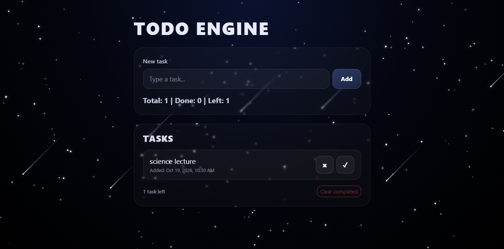

<h1 align="center">🚀 Todo Engine</h1>

<p align="center">
  A sleek, space-themed to-do list with twinkling sparkles and falling meteors.<br>
  Built with HTML, Bootstrap 5 and vanilla JavaScript.
</p>

<p align="center">
  
  
  
</p>

<p align="center">
  
</p>

---

## ✨ Features

- **Add tasks** quickly with the input box and the Add button
- **Mark tasks as done** with the ✓ button (click again to undo)
- **Delete tasks** with the x button
- **Live stats** showing `Total | Done | Left`
- **Clear completed** tasks in one click
- **Saved automatically** in your browser with `localStorage`, so tasks stay after a refresh
- **Timestamps** showing when each task was added
- **Space theme** with a dark gradient background and see-through glass cards
- **Animated sparkles and meteors** drawn on an HTML canvas
- **Responsive** layout that works on phones, tablets and desktops
- **Reduced motion support**: the animation calms down for people who prefer less movement

## 📸 Screenshots

| Home | Tasks added | Mobile view |
| :---: | :---: | :---: |
|  |  |  |

## 🛠️ Built With

| Technology | Used for |
| --- | --- |
| HTML5 | Page structure |
| Bootstrap 5.3 | Layout and responsive grid |
| CSS3 | Space theme, glass cards, buttons |
| JavaScript (ES6) | Task logic, storage, canvas animation |
| Canvas API | Sparkles and meteors |
| localStorage | Saving tasks in the browser |

## 📂 Project Structure

```
to-do/
├── index.html        # Page layout and styling
├── to-do.js          # Task logic + sparkles and meteors animation
├── screenshots/      # Images used in this README
└── README.md
```

## ▶️ Getting Started

No installation needed.

1. **Clone the repository**
   ```bash
   git clone https://github.com/adyyyy0008/to-do-list-.git
   ```
2. **Open the folder**
   ```bash
   cd to-do-list-
   ```
3. **Open `index.html`** in your browser, or run it with the **Live Server** extension in VS Code.

## 🎛️ Customize the Background

Open `to-do.js` and edit the settings at the top of the sparkles section:

| Setting | What it does |
| --- | --- |
| `PARTICLE_DENSITY` | More or fewer sparkles |
| `MAX_SIZE` | Bigger or smaller sparkles |
| `METEOR_COUNT` | Number of meteors |
| `METEOR_MIN_SPEED` / `METEOR_MAX_SPEED` | How fast meteors fall |
| `METEOR_MAX_LENGTH` | Length of the meteor tails |
| `METEOR_MAX_DELAY` | How often meteors appear (lower = more often) |

## 🙏 Credits

The sparkles and meteors are inspired by the [Aceternity UI](https://ui.aceternity.com/components/sparkles) components and rebuilt in plain JavaScript.

## 👤 Author

Made by **[@adyyyy0008](https://github.com/adyyyy0008)**

If you like this project, give it a ⭐ on GitHub.
